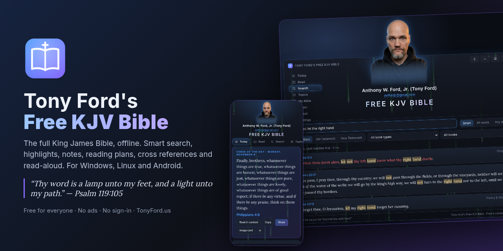

# Tony Ford's Free KJV Bible

**Created by Anthony W. Ford, Jr. (Tony Ford)** · awfordjr@gmail.com · https://TonyFord.us

The complete King James Bible (66 books, 31,102 verses), fully offline, free, with no ads, no account and no tracking.
Made for Windows PCs, Linux PCs and Android phones.

## Downloads

| System | Download | How to run |
|---|---|---|
| Windows 10/11 (64-bit) | [**TonyFordsFreeKJVBible.exe**](https://github.com/AWFordJr/Tony-Fords-Free-KJV-Bible/blob/main/Downloads/TonyFordsFreeKJVBible.exe?raw=1) | Portable: no installer. Put it in any folder and double-click. Uses the Microsoft Edge WebView2 that comes with Windows 10/11. |
| Linux PC (x86_64) | [**Tony-Fords-Free-KJV-Bible_1.0.0_amd64.AppImage**](https://github.com/AWFordJr/Tony-Fords-Free-KJV-Bible/blob/main/Downloads/Tony-Fords-Free-KJV-Bible_1.0.0_amd64.AppImage?raw=1) | Portable AppImage: make it executable (`chmod +x`) and run it. |
| Android 7.0 and newer | [**Tony-Fords-Free-KJV-Bible_1.0.0.apk**](https://github.com/AWFordJr/Tony-Fords-Free-KJV-Bible/blob/main/Downloads/Tony-Fords-Free-KJV-Bible_1.0.0.apk?raw=1) | Copy the APK to your phone, open it and allow "install unknown apps" for your file manager. |

SHA-256 checksums are in [`Downloads/SHA256SUMS.txt`](Downloads/SHA256SUMS.txt), and test results are in [`TEST-NOTE.txt`](TEST-NOTE.txt).

Your highlights, bookmarks, notes and settings are saved in a folder named
**"Tony Ford's Free KJV Bible Data"** right next to the exe or AppImage, so you can carry the
app and your notes on a USB stick. On Android they are saved inside the app.
Use **Settings → Back up** to save a backup file any time.

## What it does

- **Read** the whole KJV with smooth scrolling, chapter arrows, a quick book picker, and "Go to" (type *John 3:16*).
- **Smart search** that forgives you: `Dont let the right hand` finds Matthew 6:3, `Love thy neibor` fixes the spelling
  and finds Leviticus 19:18, Matthew 22:39, Mark 12:31 and Romans 13:9. Modern words are matched to KJV words
  (you → thee/thou/ye, gives → giveth). Modes: Smart, All words, Any word, and "exact phrases" in quotes.
  Filter by Old/New Testament, book type (Law, History, Poetry & Wisdom, Prophets, Gospels, Epistles…) or one book.
  Results are ranked with your words highlighted. Recent searches are remembered.
- **Topics**: type a subject like *marriage*, *forgiveness*, *anxiety* and get the key verses, plus over 4,600
  topics from Nave's Topical Bible.
- **Today**: a Verse of the Day, "Continue reading", recently read chapters, and **reading plans**
  (Bible in a Year, New Testament in 90 Days, Psalms & Proverbs in 31 Days, Gospels in 30 Days) with progress.
- **Highlights** in 5 colors, **bookmarks** and **notes**, all listed in *My Bible*.
- **Share**: copy a verse or range with its reference (reference first or last), share to email, X or Facebook,
  the Android share sheet, or make a pretty **verse image card**.
- **Study**: Treasury of Scripture Knowledge **cross references** and **Strong's numbers** for every word,
  with how the KJV translates each Hebrew/Greek word and every verse that uses it.
- **Words of Jesus in red** (can be turned off).
- **Read aloud** with your device's own voices.
- Dark, Light, Sepia and Night themes; text size; line spacing; the Lora book font or the
  dyslexia-friendly OpenDyslexic font.
- Keyboard shortcuts on PC (← → chapters, Ctrl+F search, Ctrl+G go to, Ctrl +/− text size, R read aloud,
  B bookmark, C copy, N note, S share, 1–5 highlight colors, 0 remove highlight, T Today, Esc close)
  and swipe left/right for chapters on Android.
- Optional **Music** tab for internet radio (only this tab uses the internet).

## Sources and licenses

- **Bible text**: King James Version, 1769 text, from eBible.org "eng-kjv" — **public domain**.
- **Words of Jesus and Strong's numbers**: from the same eBible.org KJV files — public domain.
  (No copyrighted Strong's dictionary definitions are included.)
- **Cross references**: Treasury of Scripture Knowledge — public domain.
- **Topics**: Nave's Topical Bible (1897) — public domain; digital transcription by Brady Stephenson,
  BibleData (CC BY 4.0), github.com/BradyStephenson/bible-data. Everyday topics hand-built for this app.
- **Fonts**: Lora and OpenDyslexic — SIL Open Font License 1.1.
- **Icon and artwork**: made for this app.

## License

Free for non-commercial use. Share the unchanged files freely. No changes, no rebranding,
no credit-taking, no selling or profit. (CC BY-NC-ND 4.0) See `LICENSE-and-CREDITS.txt`.

© Anthony W. Ford, Jr. (Tony Ford) · TonyFord.us
